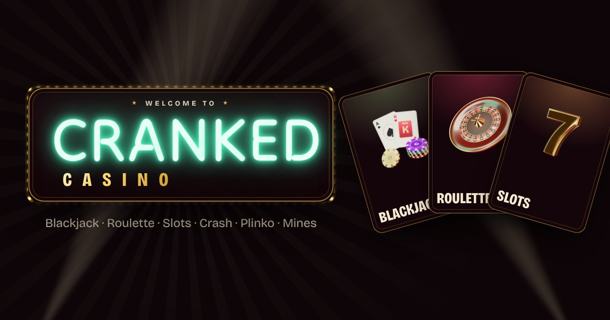

# CrankedCasino



A fake-money online casino that runs entirely on GitHub Pages. It has six original games and a neon "after hours" look, and it saves your progress to your GitHub account.

**Games**

| Game | What happens | Return to player |
| --- | --- | --- |
| **Blackjack** | Six-deck shoe with a cut card. Hit, stand, double, split and insurance. The dealer stands on all 17s and blackjack pays 3:2. Cards are dealt from the shoe with flip animations, and chips fly in and out. | ≈99.5% (basic strategy) |
| **Roulette** | Single-zero European wheel with a rolling ball that lands in the winning pocket. Bet straight up (35:1), on dozens and columns (2:1), and on red/black, odd/even and 1–18/19–36 (1:1). Undo, double, rebet and quick spin. | 97.3% |
| **Slots** | Five reels, ten lines, wilds, and bonus stars that trigger free spins at ×2 (with retriggers). Turbo and autoplay. | ≈97.5% |
| **Crash** | A rocket climbs a live multiplier curve until it explodes. Cash out in time, or set an auto cash-out. | 99% |
| **Plinko** | Drop balls through 8–16 rows of pegs, with three risk levels, up to 1,000×. Manual or auto drop. | ≈99% |
| **Mines** | Flip tiles on a 5×5 grid, collect gems, dodge 1–24 bombs, and cash out whenever you like. | 99% |

Every card, spin and bounce comes from the browser's cryptographic random number generator (`crypto.getRandomValues`).

**Also included**

- **Cashier:** a daily +1,000 bonus, a refill when you're broke, and **promo codes**.
- **Profile:** a leaderboard and per-game stats.
- **Look and feel:** synthesized sound effects (no audio files), a daylight theme, reduced-motion support and keyboard shortcuts. It also installs to your phone's home screen as an app.

> Chips are pretend. Nothing can be bought, won or withdrawn.

## Promo codes

Players redeem codes from the 🎟 ticket button in the header, from the cashier (tap your balance), from the lobby's golden ticket, or from their profile. Each code works **once per player**, and codes are not case-sensitive.

The site ships with:

| Code | Reward |
| --- | --- |
| `MaxWin` | +1,000 chips |

To add or change codes, edit `PROMOS` in [`js/store.js`](js/store.js):

```js
export const PROMOS = {
  MAXWIN: { chips: 1000, note: 'MaxWin bonus' },
  HIGHROLLER: { chips: 5000, note: 'Launch party' }, // keys are UPPERCASE
};
```

## Put it online with GitHub Pages

1. Open the repo on GitHub → **Settings** → **Pages**.
2. Under **Build and deployment**, set **Source** to **Deploy from a branch**.
3. Pick the branch that holds this code (for example `main`) and the **/ (root)** folder, then **Save**.
4. After a minute the casino is live at **https://ll2rawll.github.io/CrankedCasino/**.

There's no build step. The site is plain HTML, CSS and JavaScript modules, and the fonts and libraries are bundled in the repo.

## Turn on GitHub sign-in

Without this, everything still works and chips are saved in the visitor's browser. With it, players can **Sign in with GitHub**. Their stack, stats, promo redemptions and history are then saved to their account and follow them to any device, and they appear on the leaderboard.

GitHub Pages can't keep secrets, so sign-in goes through [Supabase](https://supabase.com) (free tier). It takes about 5 minutes:

1. **Create a Supabase project** at [supabase.com/dashboard](https://supabase.com/dashboard).
2. **Create the database table.** Open **SQL Editor** → **New query**, paste all of [`supabase/schema.sql`](supabase/schema.sql), and press **Run**.
3. **Create a GitHub OAuth app.** On GitHub go to **Settings** → **Developer settings** → **OAuth Apps** → **New OAuth App**:
   - *Homepage URL:* `https://ll2rawll.github.io/CrankedCasino/`
   - *Authorization callback URL:* `https://<your-project-ref>.supabase.co/auth/v1/callback`

     Supabase shows this exact URL under **Authentication** → **Sign In / Providers** → **GitHub**.
   - Register the app, then copy the **Client ID** and generate a **Client secret**.
4. **Enable GitHub in Supabase.** In **Authentication** → **Sign In / Providers** → **GitHub**, switch it on and paste the Client ID and secret.
5. **Allow the site to receive the login.** In **Authentication** → **URL Configuration**:
   - *Site URL:* `https://ll2rawll.github.io/CrankedCasino/`
   - *Redirect URLs:* add `https://ll2rawll.github.io/CrankedCasino/**`. Add `http://localhost:8080/**` too if you test locally.
6. **Connect the site.** Copy the **Project URL** and the **anon** / **publishable** key from **Project Settings** → **API** into [`js/config.js`](js/config.js), then commit and push.

Both values are meant to be public. The database rules only let each player read and write their own save, and the leaderboard only exposes usernames, avatars and numbers.

### How saving works

- **Guests:** progress lives in `localStorage` on that device.
- **First GitHub sign-in:** the guest's progress (including redeemed promo codes) moves into their account, and the guest slot starts fresh.
- **Signed in:** every change is saved about 1.5 seconds after it happens, and again when the tab is hidden or closed. If two devices disagree, the newest save wins.
- **Mid-game:** wins that are still animating are already counted in the saved balance. An unfinished Mines round resumes where you left it, and leaving Blackjack mid-hand settles the hand automatically.
- **Paused projects:** free Supabase projects pause after a week without traffic. The casino falls back to on-device saves until you un-pause the project.

The games run in the browser, so a determined player could edit their own balance or redeem a code twice by resetting their save. That's fine for fake chips; just treat the leaderboard as an honour system.

## Run it locally

```bash
python3 -m http.server 8080
# then open http://localhost:8080
```

## Project layout

```
index.html               app shell (header, cashier, menu, footer)
css/base.css             design system: tokens, neon, buttons, chips, cashier, promo ticket
css/lobby.css            neon marquee, holo card deck, cashier section
css/games.css            game frame, Mines, Plinko, Slots, Crash, leaderboard, profile
css/tables.css           felt tables, playing cards, chips, Blackjack and Roulette
js/main.js               header, cashier, menu, theme, hash router
js/store.js              balance, bets, stats, history, promo codes, local saves
js/cloud.js              GitHub sign-in and cloud saves (Supabase)
js/config.js             ← your Supabase URL and key go here
js/games/*.js            blackjack, roulette, slots, crash, plinko, mines (+ cards.js deck and shoe)
js/pages/*.js            lobby, leaderboard, profile
js/sound.js, fx.js       synthesized sound effects, particles, coin rain
assets/                  fonts (Tilt Neon, Bricolage Grotesque), 3D card art, slot symbols, icons
supabase/schema.sql      database table, security rules, leaderboard function
tools/                   scripts that re-render the 3D art, share image and app icons
vendor/                  supabase-js (site), three.js (art tools only)
```

To re-render the 3D card art after editing `tools/art3d.js`, serve the repo on port 8765 and run `node tools/render-assets.mjs`. This needs Playwright and Python with Pillow.

## Credits

[supabase-js](https://github.com/supabase/supabase-js) and [Three.js](https://threejs.org) are MIT licensed. The fonts, [Tilt Neon](https://github.com/googlefonts/Tilt-Fonts) and [Bricolage Grotesque](https://github.com/ateliertriay/bricolage), are under the SIL Open Font License. All game art, cards, chips, symbols and sounds are original to this project.
